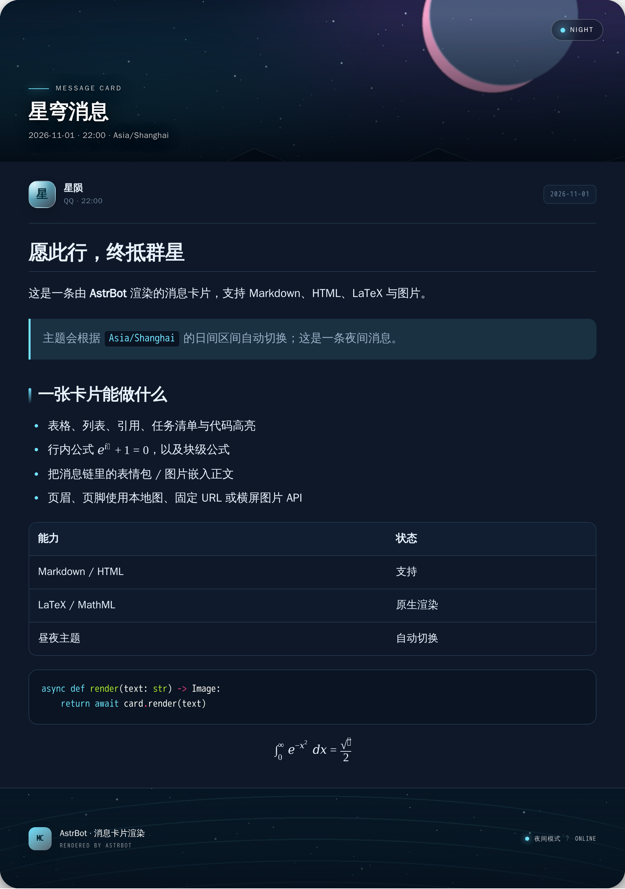
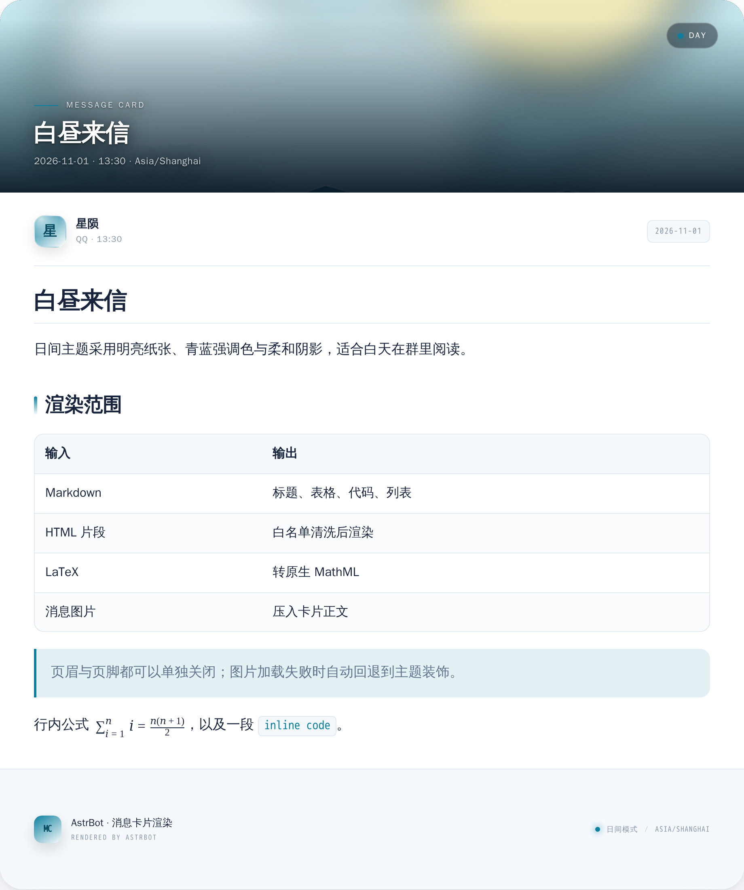

<div align="center">

[](https://github.com/AstrBotDevs/AstrBot)


# 消息卡片渲染

把 AstrBot 的回复变成一张真正好看的图片：**Markdown、HTML、LaTeX、图片**，<br>
白昼/夜间主题按时区自动切换，页眉页脚可接入横屏图片 API。

[功能](#-功能特性) · [安装](#-安装) · [配置](#-配置) · [指令](#-指令) · [安全](#-安全设计) · [排错](#-常见问题)

</div>

---

<div align="center">




<sub>左：夜间主题 + 图片 API 风格的横屏页眉 + 图片页脚；右：日间主题。</sub>

</div>

---

## 📖 简介

**消息卡片渲染**在 AstrBot 的消息输出阶段接管 LLM 回复，用无头 Chromium 把消息渲染成一张自包含的图片。它不是简单的“文字贴图”：Markdown 表格/代码块、HTML 片段、LaTeX 公式、消息链里的表情包都会进入同一张排版后的卡片。

主题由 **IANA 时区 + 可配置的日间区间**决定：默认 `Asia/Shanghai` 的 `06:30–18:30` 使用日间主题，其余时间使用夜间主题。页眉/页脚支持本地图片、固定 URL 和横屏图片 API；默认生成失败不会影响正常聊天，而是保留原消息。

> 本项目面向 AstrBot 4.x，遵循官方插件开发规范。渲染全部在本机完成，不依赖外部 T2I 服务。

## ✨ 功能特性

- 🎨 **真正的昼夜主题**：`auto/light/dark` 三种模式；基于 `zoneinfo` 的时区与日间区间，支持跨午夜区间，主题不是写死的两张皮。
- 🧾 **Markdown 全量排版**：标题、表格、引用、任务列表、脚注、围栏代码 + Pygments 高亮、图片、链接、`details` 等。
- 🧩 **HTML 片段渲染**：白名单标签/属性 + CSS 安全属性白名单；不执行脚本，不加载外部样式，不引入 iframe。
- ∑ **LaTeX 原生 MathML**：`$...$`、`$$...$$`、`\(...\)`、`\[...\]` 和常见 `\begin{...}` 环境；无需 MathJax CDN，离线可用。
- 🖼️ **消息图片进入卡片**：图片组件会转成 data URI 嵌入正文，统一缩放到固定长边 `content.image_size`（默认 380px）并保持原比例；[meme_manager](https://github.com/anka-afk/astrbot_plugin_meme_manager) 通过 `on_decorating_result(priority=99999)` 加入的表情包会被本插件（priority=-100）接住。
- 👤 **头像**：发送者区域优先显示 QQ 头像，获取失败回退昵称首字；页脚显示机器人头像和机器人昵称，获取失败回退机器人昵称首字。
- 🏞️ **页眉/页脚图片**：`theme / local / url / api` 四种来源；支持 `cover/contain`、裁剪焦点、文字开关和独立高度。
- 🌐 **横屏图片 API**：可配置任意横屏接口，例如 `https://api.cnmiw.com/api.php?sort=CDNpc`；支持直接返回图片、返回 JSON URL、302 跳转；失败自动回退到主题装饰。
- 🐳 **Docker 宿主机回退**：当 API 主机是 `127.0.0.1` 且容器内不通时，依次尝试 `host.docker.internal`、Docker 网关、`172.17.0.1`。
- 🧷 **输出阶段接管**：只在合适的时候转换；默认仅处理 LLM 回复、跳过短纯文本和流式输出；命令输出/纯图片默认不动。
- 🧩 **内置功能共存开关**：可选择保留 AstrBot 的分段回复、TTS、转发消息字数阈值，避免“先转图导致核心功能失效”。
- 🛡️ **安全默认值**：正文远程图片有 SSRF 防护、大小/像素限制；正文默认不能读本地文件；Chromium 禁用 JS 并阻断所有非 data URI 请求。
- 🧵 **长图自动切片**：超过 `max_slice_height` 时按视口切片，避免超过 Chromium 位图上限；返回多张图片。
- 🧹 **自动清理**：生成文件保存在 `data/plugin_data/astrbot_plugin_message_card/renders`，按数量保留最近文件。
- 🖥️ **插件 WebUI**：在 AstrBot 插件详情页打开「消息卡片设置」，可视化调整卡片标题、字号、图片尺寸、主题、页眉页脚与兼容开关，并一键渲染预览。

## 📦 安装

### 方式一：插件市场（推荐）

在 AstrBot WebUI 的 **插件 → 插件市场** 搜索「消息卡片渲染」或 `astrbot_plugin_message_card` 安装。

### 方式二：手动安装

```bash
cd AstrBot/data/plugins
git clone https://github.com/XingYunStar/astrbot_plugin_message_card.git
```

重启 AstrBot，或到 WebUI 插件页重载插件。AstrBot 会自动安装 `requirements.txt`。

### 浏览器依赖（必看）

本插件需要 Chromium。二选一：

```bash
# A. 使用 Playwright 自带浏览器（首次约下载 150 MB）
python -m playwright install chromium
# 若系统缺少运行库：
python -m playwright install-deps chromium

# B. 使用系统 Chromium / Chrome，然后在插件配置里填路径
#    Debian/Ubuntu: apt-get install -y chromium fonts-noto-cjk fonts-noto-color-emoji
#    browser_path: /usr/bin/chromium
```

> [!TIP]
> 如果日志出现 `无法启动 Chromium`，先执行 `python -m playwright install chromium`，或把 `render.browser_path` 指向可执行文件。插件不会在启动时自动下载浏览器，避免首次加载不可控地占用带宽。

**字体建议**：容器内至少安装一套中文字体（`fonts-noto-cjk` 或文泉驿），否则中文会显示豆腐块；需要彩色 Emoji 时安装 `fonts-noto-color-emoji`。插件字体栈已包含 `Noto Color Emoji` / `Apple Color Emoji` / `Segoe UI Emoji`，但系统里必须真的有对应字体。

## 🚀 快速开始

1. 安装并重载插件，确认 Chromium 可用。
2. 打开 WebUI 的插件配置，按需调整：
   - `theme.timezone`：例如 `Asia/Shanghai`
   - `theme.day_start` / `theme.day_end`：例如 `06:30` / `18:30`
   - `trigger.min_chars`：短消息不转图，默认 24
3. 想使用自己的横屏图 API：把 `header.source` 改成 `api`，`header.api_url` 填，例如：
   ```
   https://api.cnmiw.com/api.php?sort=CDNpc
   ```
   如果 API 是宿主机本地服务，Docker 场景请按下方「[Docker 与 127.0.0.1](https://github.com/XingYunStar/astrbot_plugin_message_card#docker-与-127001)」处理。
4. 发送一段较长的 Markdown/LaTeX 测试，或直接：

   ```text
   /render # 测试
   $$
   \int_0^\infty e^{-x^2}dx=\frac{\sqrt{\pi}}{2}
   $$
   ```

## 🖥️ WebUI 设置页

插件自带一个可视化设置页，不需要手改 JSON：

1. 打开 AstrBot WebUI → **插件** → 消息卡片渲染 → **插件详情**。
2. 打开 **消息卡片设置** 页面。
3. 修改后点击「保存配置」，配置立即生效；右侧可以直接渲染预览。

页面包含：

- `header.title`「卡片标题」：把默认的「消息卡片」改成任意文字
- 正文字号、卡片宽度、图片长边、圆角、行高
- 昼夜主题、时区、日间区间
- 页眉/页脚图片源、横屏 API、高度、是否显示文字
- 分段回复、TTS、转发阈值兼容开关
- 实时预览和运行状态

> 页面通过 AstrBot 的插件 Pages bridge 读写插件配置；保存后无需重启 AstrBot，下一次渲染即使用新配置。

## 🎛️ 配置

完整字段、默认值与说明见 [`_conf_schema.json`](_conf_schema.json)，WebUI 会按分组展示。以下是高频项：

| 配置 | 默认 | 说明 |
| --- | --- | --- |
| `enabled` | `true` | 总开关；关闭后仍可用 `/render` 手动测试 |
| `trigger.mode` | `llm` | `llm` 仅 LLM；`all` 所有发送结果；`command` 只手动 |
| `trigger.min_chars` | `24` | 纯文本短于该值不自动转图；富文本不受限 |
| `trigger.render_when_rich` | `true` | 短但含 Markdown/公式/HTML/图片也渲染 |
| `trigger.skip_streaming` | `true` | 跳过流式，避免重复发图 |
| `trigger.render_image_only` | `false` | 只有表情包/图片的消息是否也套卡片 |
| `trigger.include_meme_manager_pending` | `true` | 将 [meme_manager](https://github.com/anka-afk/astrbot_plugin_meme_manager) 待发表的单独表情并入卡片 |
| `theme.mode` | `auto` | `auto` / `light` / `dark` |
| `theme.timezone` | `Asia/Shanghai` | IANA 时区 |
| `theme.day_start` | `06:30` | 日间开始（含） |
| `theme.day_end` | `18:30` | 日间结束（不含） |
| `appearance.width` | `720` | 卡片宽度（CSS px），手机端建议 720 |
| `appearance.font_size` | `28` | 正文字号（CSS px） |
| `header.title` | `消息卡片` | 页眉大字标题，可完全自定义 |
| `header.source` | `theme` | `theme` / `local` / `url` / `api` |
| `header.height` | `280` | 页眉高度（CSS px） |
| `header.api_url` | 示例 `https://api.cnmiw.com/api.php?sort=CDNpc` | 横屏图片 API |
| `header.host_fallback` | `true` | 容器访问宿主机的地址回退 |
| `header.cache_seconds` | `45` | 0 = 每条消息重新取图；随机图可设 0 |
| `footer.source` | `theme` | 页脚图片源，规则同页眉 |
| `footer.text` | `{bot_name}` | 页脚主文字，默认机器人昵称 |
| `footer.height` | `160` | 页脚高度（CSS px） |
| `render.device_scale_factor` | `2.0` | 2 倍分辨率输出 |
| `render.max_slice_height` | `7000` | 超过该 CSS 高度自动切片 |
| `content.input_mode` | `auto` | 自动识别 HTML，否则 Markdown |
| `content.allow_remote_images` | `true` | 正文远程图片 |
| `content.allow_private_network_images` | `false` | 正文访问内网（高风险） |
| `content.image_size` | `380` | 正文图片固定长边（等比例缩放） |
| `content.allow_local_images` | `false` | 正文读取本地文件（高风险） |
| `compat.preserve_segmented_reply` | `false` | 分段回复会实际拆分时停止转图 |
| `compat.preserve_tts` | `false` | 转图后同时生成语音 |
| `compat.preserve_forward_threshold` | `false` | 超过转发阈值时停止转图 |

### 占位符

页眉标题/副标题、页脚文字、页眉页脚的 `path` / `url` / `api_url` 支持：

| 占位符 | 值 |
| --- | --- |
| `{date}` | 主题时区下的日期 |
| `{time}` | 主题时区下的时间 |
| `{datetime}` | 日期 + 时间 |
| `{timezone}` / `{tz}` | 时区名 |
| `{sender}` | 发送者昵称 |
| `{platform}` | 平台标签，如 `QQ` |
| `{theme}` | `日间模式` / `夜间模式` |
| `{bot_name}` | 机器人昵称（页脚默认使用） |
| `{bot_id}` | 机器人账号 ID |
| `{weekday}` | 星期几 |

### 主题区间

- 区间是 **左闭右开**：`06:30–18:30` 的 `18:30` 属于夜间。
- 支持跨午夜：`20:00–06:00` 表示晚 8 点到次日早 6 点为日间（极昼/倒班场景）。
- 起止相等时视为全天日间；时区无效时回退 `Asia/Shanghai`；时间格式无效时回退默认值，不会让插件崩溃。
- 主题只影响配色，不影响页眉/页脚图片。

### 页眉/页脚图片 API

`api` 模式支持三种返回：

1. 直接返回图片二进制（`Content-Type: image/*`）。
2. 返回 JSON：用 `api_json_path` 指定字段，例如 `data.url`、`result.images[0]`；留空自动寻找第一个图片 URL。
3. 返回 302 跳转到图片，插件会跟随最多 3 次重定向。

如果接口返回 JSON 中的 URL 没有 `.png/.jpg` 后缀，插件在常见字段（`url`、`image`、`src` 等）下也能识别。

### Docker 与 `127.0.0.1`

`127.0.0.1` 永远指向 **AstrBot 容器自己**，不是宿主机。推荐顺序：

1. 让 API 监听 `0.0.0.0`，在配置里填宿主机局域网 IP，例如 `http://192.168.1.10:8888/...`。
2. 给容器加 `extra_hosts: ["host.docker.internal:host-gateway"]`，配置 `http://host.docker.internal:8888/...`。
3. 保留默认 `127.0.0.1` 并开启 `header.host_fallback`，插件会尝试 `host.docker.internal`、Docker 默认网关、`172.17.0.1`。

> 回退是 best-effort：如果容器的网关不是宿主机、或宿主防火墙未放行 8888，仍需用局域网 IP / host-gateway。日志会打印一次失败原因，之后 90 秒内不再重复尝试失败接口。

### 宿主机 API 只监听 127.0.0.1 时

如果图片服务只绑定在宿主机 `127.0.0.1:8888`，Docker 容器无法通过 bridge 直接访问。可以在宿主机上用 host network 跑一个反向代理（示例：[`tools/host_api_proxy.py`](tools/host_api_proxy.py)），把 `0.0.0.0:8890` 转发到 `127.0.0.1:8888`，然后把插件配置改为：

```text
header.source = api
header.api_url = http://172.17.0.1:8890/<你的API路径>
```

示例：

```bash
docker run -d --name astrbot-image-proxy --restart unless-stopped --network host \
  -v "$PWD/tools/host_api_proxy.py:/api_proxy.py:ro" \
  --entrypoint python <任意带 python 的镜像> /api_proxy.py
```

`172.17.0.1` 是 Docker 默认 bridge 网关；如果容器在自定义网络，使用 `docker network inspect <网络名>` 中的 Gateway 地址。

## ⌨️ 指令

| 指令 | 说明 |
| --- | --- |
| `/render <内容>` | 渲染 Markdown/HTML/LaTeX；自动识别格式 |
| `/render html <内容>` | 强制按 HTML 片段渲染 |
| `/render md <内容>` | 强制按 Markdown 渲染 |
| `/render` | 渲染被引用消息（先引用，再发送 `/render`） |
| `/render status` | 查看当前主题、时区、浏览器、页眉页脚配置 |
| `/render help` | 帮助 |
| `/渲染` / `/消息卡片` | 同 `/render` 的别名 |

> 手动渲染不受 `trigger` 的字数/模式限制，也不要求消息来自 LLM。

## 🎨 渲染范围与行为

### 支持的输入

| 输入 | 处理方式 |
| --- | --- |
| Markdown | Python-Markdown + Pygments + 内置表格/代码/引用 CSS |
| HTML 片段 | 白名单清洗后放入卡片正文，可使用安全内联样式 |
| LaTeX | 转成 MathML；失败时保留原始公式文本并写 debug 日志 |
| 消息链图片 | 转 data URI 后按原顺序插入 Markdown/HTML |
| 网络图片 | 下载、校验、压缩后转 data URI |
| 纯图片消息 | 默认跳过；`render_image_only=true` 或 `/render` 时渲染 |

### 不做什么

- 不执行 HTML 中的 `<script>`、`on*` 事件、`iframe`、`object`、`embed`。
- 不加载 `<style>` 标签、外部 CSS、外部字体；HTML 片段的样式请用内联 `style`。
- 不允许正文访问内网/本机图片（默认）；页眉/页脚 API 属于管理员配置，允许私网。
- 不拦截其他插件绕过事件结果、直接通过 `context.send_message` 发出的消息。

### 与 [meme_manager](https://github.com/anka-afk/astrbot_plugin_meme_manager) 的配合

[meme_manager](https://github.com/anka-afk/astrbot_plugin_meme_manager) 在 `on_decorating_result(priority=99999)` 把选中的表情包混入消息链，本插件在 `priority=-100` 更晚执行，因此：

- ✅ 混合发送（文字 + 表情）时，表情会进入卡片。
- ✅ [meme_manager](https://github.com/anka-afk/astrbot_plugin_meme_manager) 的“非混合”模式会把表情放进 `meme_manager_pending_images`，计划在 `after_message_sent` 再发。本插件默认读取这个列表，把它们并入卡片，并在成功渲染后清空，避免重复发送。
- ⚠️ 如果关闭 `trigger.include_meme_manager_pending`，或者 [meme_manager](https://github.com/anka-afk/astrbot_plugin_meme_manager) 使用 `context.send_message` 绕过事件 extras 直接发送，表情仍会作为独立图片发出，不会进入卡片。
- 该集成是对 [meme_manager](https://github.com/anka-afk/astrbot_plugin_meme_manager) 当前事件字段的兼容读取；字段不存在时完全无副作用。

## 🧩 与 AstrBot 内置功能共存

插件在 `on_decorating_result` 阶段执行，早于 AstrBot 的分段回复、TTS、T2I 和转发消息字数阈值。默认 `compat.*` 全部关闭，因此插件成功转图后，核心的这些文本功能对该条消息不再生效。开启对应开关后：

| 配置 | 开启后的行为 |
| --- | --- |
| `compat.preserve_segmented_reply` | 如果当前消息**实际会被** AstrBot 分段（平台允许、`only_llm_result` 匹配、某段文本不超过阈值且拆分结果大于 1 段），本插件跳过转图，交给核心分段。 |
| `compat.preserve_tts` | 转图成功后，按核心 TTS 配置（总开关、会话开关、概率、Provider）自行合成语音，追加到图片消息之后。最终是「图片 + 语音」，不重复文字。 |
| `compat.preserve_forward_threshold` | 仅 `aiocqhttp`：原文 Plain 字数超过 `platform_settings.forward_threshold` 时跳过转图，让核心执行合并转发。低于阈值仍转图。 |

补充说明：

- 三个开关默认 `false`，保持“转图优先”的行为；需要保留核心功能时逐项打开。
- 分段回复/Docker 转发是**停止转图**类开关，不是“图片再分段/图片再转发”。图片无法按标点拆分，也无法参与 Plain 字数统计。
- 开启 `preserve_tts` 后，核心 TTS 阶段看到的仍然只有图片/语音组件，因此不会二次合成。`dual_output` 的文字不会被重复追加，卡片本身已经包含文字。
- 追加语音后消息链包含 `Record`，AstrBot 的 `@`/引用回复装饰可能不再执行，这与核心 TTS 的原始行为一致。
- 如果 TTS 合成失败或概率未命中，只发送图片，不会回退成“图片 + 重复文字”。

## 🛡️ 安全设计

1. **HTML 白名单**：Bleach 清洗标签/属性/协议；`style` 只保留颜色、间距、字号、边框等安全 CSS 属性，`background`、`position`、`url()` 被移除。
2. **MathML 白名单**：LaTeX2MathML 生成的 MathML 再经一次标签/属性清洗，防止 `\text{}` 中构造 HTML。
3. **无脚本浏览器**：Chromium 关闭 JavaScript；所有非 `data:` / `about:` 请求被 route 阻断。页面是 self-contained 的。
4. **SSRF 防护**：正文远程图片解析域名后拒绝 loopback/私网/链路本地/保留地址；重定向再次校验。默认不允许正文引用本地文件。
5. **图片校验**：Pillow 校验格式、像素数与体积；重新编码为 PNG/JPEG，剥离元数据，避免畸形图片/解压炸弹。
6. **管理员配置**：页眉/页脚 API、`custom_css`、`allow_private_network_images`、`allow_local_images` 属于可信配置，仍建议只给管理员修改权限。

> 把 `allow_private_network_images` 或 `allow_local_images` 打开会显著扩大攻击面；只在你完全信任消息来源时使用。

## 🧪 本地自测

```bash
# 纯逻辑测试（不需要浏览器）
PYTHONPATH=. python -m unittest discover -s astrbot_plugin_message_card/tests -v

# 浏览器端到端冒烟测试
RUN_RENDER_TESTS=1 MESSAGE_CARD_CHROME=/usr/bin/chromium \
  PYTHONPATH=. python -m unittest astrbot_plugin_message_card.tests.test_smoke_render -v

# 重新生成 README 预览图
PYTHONPATH=. python -m astrbot_plugin_message_card.tests.generate_previews
```

测试覆盖：主题边界/跨午夜/非法时区、Markdown/表格/代码/公式、HTML 清洗、MathML 注入、data URI 图片、SSRF 拒绝、长图切片、真实 Chromium 截图。

## 🧯 常见问题

<details>
<summary><b>没有自动转图</b></summary>

按顺序检查：

1. `enabled` 是否为 true，`trigger.mode` 是否为 `llm`（默认只处理 LLM 回复）。
2. 纯文本是否短于 `trigger.min_chars`，且没有标题/表格/代码/公式/图片等富文本特征。
3. 消息是否只有图片而 `render_image_only=false`。
4. 平台是否在 `trigger.skip_platforms` 中。
5. 流式输出是否被 `skip_streaming=true` 跳过。
6. 日志是否出现 `自动渲染失败，保留原文`。

也可以先用 `/render 测试` 排除消息管线差异。

</details>

<details>
<summary><b>Chromium 启动失败</b></summary>

```bash
python -m playwright install chromium
python -m playwright install-deps chromium
# 或
apt-get install -y chromium
```

然后在配置 `render.browser_path` 填 `/usr/bin/chromium`。查看 `/render status` 的浏览器路径与最近错误。

</details>

<details>
<summary><b>中文/Emoji 是方块</b></summary>

```bash
# Debian/Ubuntu
apt-get install -y fonts-noto-cjk fonts-noto-color-emoji
fc-cache -fv
```

插件字体栈优先使用 Noto Sans SC / 思源黑体 / 微软雅黑 / 文泉驿，再回退系统 sans-serif；彩色 Emoji 需要系统彩色字体。

</details>

<details>
<summary><b>页眉 API 不生效 / 容器里 127.0.0.1 不通</b></summary>

先确认 `header.source` 是 `api`，再在 **AstrBot 容器内** 执行：

```bash
curl -I "http://127.0.0.1:8888/<你的API路径>"
curl -I "http://host.docker.internal:8888/<你的API路径>"
```

第二条通就用 `host.docker.internal`；都不通就用宿主机局域网 IP，并确认 API 监听 `0.0.0.0`、防火墙放行 8888。开启 `header.host_fallback` 也只是尝试，不是魔法。

</details>

<details>
<summary><b>图片太长 / 被切成多张</b></summary>

超过 `render.max_slice_height`（CSS px）会自动切片，避免 Chromium 单张位图超限；切片高度还会按 `device_scale_factor` 自动封顶（约 15000 物理像素）。需要更高单张上限可调到 12000，但要考虑内存和平台图片压缩。长内容建议让 LLM 分条回复，阅读体验更好。

</details>

<details>
<summary><b>生成的图片在哪里？会占空间吗？</b></summary>

`data/plugin_data/astrbot_plugin_message_card/renders/`。插件按 `render.keep_renders` 保留最近 N 张，启动和每次渲染后清理旧文件。平台发送需要文件短时间存在，因此不要设置得过小（默认 120 足够）。

</details>

## 📂 目录结构

```text
astrbot_plugin_message_card/
├── main.py                 # AstrBot 插件入口、钩子、/render 指令
├── card_content.py         # Markdown/HTML/LaTeX 转换、清洗、图片重写
├── card_theme.py           # 时区/昼夜区间与调色板
├── card_template.py        # 卡片 HTML/CSS
├── card_assets.py          # 图片获取、API、SSRF、压缩
├── card_renderer.py        # Playwright/Chromium、长图切片、图片长边统一
├── page_web.py             # WebUI 设置页后端 API
├── tools/host_api_proxy.py  # 宿主机 loopback API 的 host-network 代理示例
├── pages/settings/         # WebUI 设置页（HTML/CSS/JS）
├── .astrbot-plugin/i18n/   # 页面标题与插件文案
├── _conf_schema.json       # WebUI 配置
├── metadata.yaml
├── requirements.txt
├── docs/                   # README 预览图与示例横幅
└── tests/                  # 单元测试、浏览器冒烟测试、预览生成
```

## 🙏 参考与致谢

- [AstrBot 插件开发文档](https://docs.astrbot.app/dev/star/plugin-new.html) 与官方[文转图指南](https://docs.astrbot.app/dev/star/guides/html-to-pic.html)
- [AstrBot 插件市场](https://cloud.astrbot.app/market) 中的同类插件提供了输出阶段交互思路；本项目未复制其代码。
- [Python-Markdown](https://python-markdown.github.io/)、[Bleach](https://bleach.readthedocs.io/)、[LaTeX2MathML](https://github.com/roniemartinez/latex2mathml)、[Pygments](https://pygments.org/)、[Playwright](https://playwright.dev/python/)
- 页面中的预览横幅为仓库内生成的抽象示意图，不包含第三方角色素材。

## 📄 License

[MIT](LICENSE)
